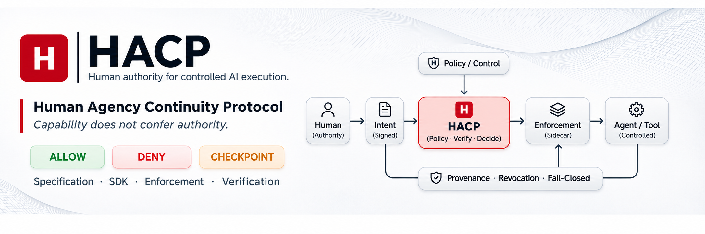

  

**Capability does not confer authority.**

HUMANIST develops **HACP — Human Agency Continuity Protocol**, a deterministic protocol and enforcement model that keeps protected AI-agent actions within explicit, verifiable human authority before execution.

Authority is evaluated against scoped intent and current control state. The resulting decision is enforced at an explicit boundary, independently of model reasoning.

### Explore the project

| Specification | SDK / Core |
| :-- | :-- |
| **[hacp-spec](https://github.com/digital-humanism/hacp-spec)** | **[humanist-core](https://github.com/digital-humanism/humanist-core)** |
| Protocol semantics, canonical binding, vectors and conformance | Developer SDK and reference authorization logic |

| Enforcement | Verification |
| :-- | :-- |
| **[hacp-sidecar](https://github.com/digital-humanism/hacp-sidecar)** | **[Conformance & evidence](https://human-authority.com/standards/conformance/)** |
| External fail-closed enforcement and deployment integration | Conformance families, reproducible results and limitations |

**Interactive Reference Surface:** [human-authority.com](https://human-authority.com/) · [Glass House](https://human-authority.com/glass-house/) · [Playground](https://human-authority.com/playground/) · [Documentation](https://human-authority.com/docs/) · [IETF publication](https://human-authority.com/standards/)

### Verification snapshot

Evidence families are reported separately, **not summed into a synthetic overall score**.

| Evidence family | Published result |
| :-- | :-- |
| HACP-Core canonical conformance | Go 38/38 · TypeScript 38/38 · Python 38/38; Rust 36 direct + 2 adjudicated / 38 |
| HC2-55 request binding | 55/55 per implementation (Go, TypeScript, Python, Rust) |
| Anti-bypass deployment evidence | 5/5 PASS |
| Go workload with real upstream forwarding | 5000/5000 PASS |

These results have distinct scopes and do not, by themselves, establish deployment security. See the [verification documentation](https://human-authority.com/docs/verification/) for methods and boundaries.

### Project origin

The [Digital Humanism Manifesto](https://github.com/digital-humanism/manifesto) establishes the broader human-agency premise. The protocol specification, implementations and interactive reference surface have their own distinct scopes and license terms.
